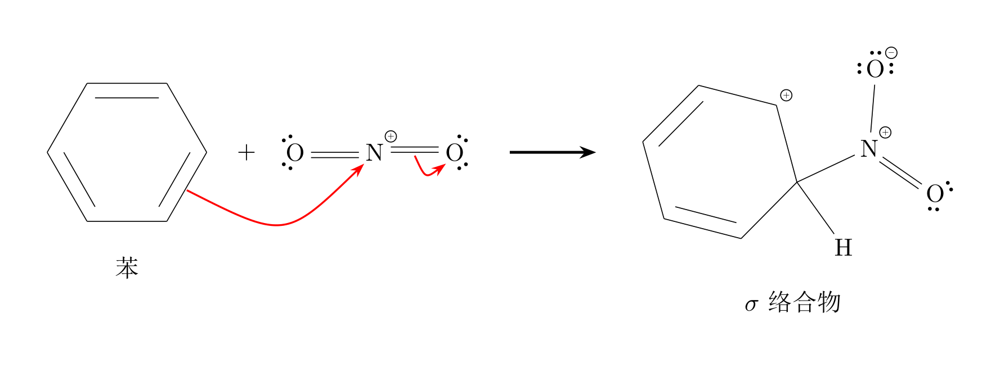

# 在 ChatGPT Work 或 Codex 中使用 Chem_Agent

Chem_Agent 在本机把化学标记转换成图片。聊天模型负责讲解和编写标记，
本项目负责校验和出图，最后由聊天模型把图片放进回答。

首次使用有两条路线：**让 Codex 按第一部分操作**，或**自己按第二部分安装**。
安装完成后，按第三部分在聊天中使用。无需配置模型 API Key、`.env` 或 MCP，
也无需启动网页服务。Python 和 LaTeX 是本机出图工具，仍然需要安装。

前提是当前任务能够读取项目目录并在本机执行命令。ChatGPT Work 的本地能力
受客户端、账户和工作区权限影响，见 [OpenAI 官方说明](https://learn.chatgpt.com/docs/enterprise/chatgpt-work-local-security)。
把文件传到聊天附件里，不代表任务就能执行这台电脑上的 Python。

## 一、让 Codex 完成安装与首次验证

先从仓库主页下载 ZIP 并解压，或使用 Git 克隆。找到同时包含 `README.md`、
`cli/`、`prompts/` 的文件夹，这就是“项目根目录”。在 Codex 中打开该项目目录，
或通过当前客户端的本地文件授权方式让任务访问它。

将下面整段文字发送给 Codex；这段指令也适用于已有本地命令能力的 Work 任务：

```text
请帮我在本机使用当前目录里的 Chem_Agent。这是安装和使用任务，不修改项目源码。

1. 先读取 docs/work.md，确认你能实际访问 cli/render.py 和 examples/work/attack.json。
   检查操作系统、可用 Python、已有虚拟环境及 XeLaTeX。不能本地执行时请明确说明。
2. 复用本机可用的项目虚拟环境；没有时在项目内创建 .venv。
   只安装 requirements/render.txt。安装和运行始终使用同一个 Python 的完整路径。
   系统缺少 Python、LaTeX 或宏包时，告诉我需要完成的安装步骤，并遵守权限提示。
3. 在项目根目录，用该 Python 运行 python -m cli.render，输入分别使用
   examples/work/attack.json 和 examples/work/rearomatization.json，输出放入 data/work/。
   校验或编译失败就排查原因，不修改安全检查、不改用图像生成模型替代。
4. 检查 PNG 确实存在且可打开，再以绝对路径在聊天正文中展示两张图片。
   如果当前界面只能给链接，请如实说明，不能把文件生成成功当成图片显示成功。
5. 告诉我以后应该使用哪个 Python 和哪些命令。不要自动提交 Git。
```

看到图片后，可以继续按第三部分提问。任务若无法执行本地命令，先处理任务的
本地访问能力；反复安装 Python 包不能解决这类问题。

## 二、自己安装并运行（Windows）

### 1. 下载项目，在正确的位置打开终端

从仓库主页下载 ZIP 后，先“全部解压”，不要直接在压缩包里运行文件。
在文件资源管理器中打开项目根目录，在地址栏输入 `powershell` 并回车。
弹出的窗口就是输入下面命令的地方；命令逐行执行，出现错误先看第四部分。

先确认位置正确：

```powershell
Test-Path .\cli\render.py
Test-Path .\requirements\render.txt
```

两条都应显示 `True`。如果显示 `False`，应进入包含这些文件的那一层目录；
不要在 `docs/` 或 `examples/` 里执行后面的命令。

### 2. 安装 Python

本教程使用普通版 Python 3.13。已有可用 Python 的用户可以复用自己的环境。
新手可从 [Python Windows 下载页](https://www.python.org/downloads/windows/) 选择
Python 3.13 的 Windows 安装程序，安装时保留 pip 和 Python Launcher，勾选
添加到 PATH 的选项。安装方式可参考 [Python 官方说明](https://docs.python.org/3.13/using/windows.html)。

安装后重新打开 PowerShell，再确认：

```powershell
py -3.13 --version
```

应显示 `Python 3.13.x`。如果提示找不到 `py`，先看第四部分。

### 3. 安装 LaTeX 出图工具

已有可用 XeLaTeX 的用户可以跳过安装。Windows 新手可按
[MiKTeX 官方安装说明](https://miktex.org/howto/install-miktex) 安装 MiKTeX，使用个人用户安装。
安装后打开 MiKTeX Console 检查更新；缺失包安装选项可以设为先询问，详见
[MiKTeX Console 说明](https://miktex.org/howto/miktex-console)。

在 Console 的 Packages 中检查并安装 `standalone`、`pgf`、`amsmath`、`ctex`；
其中 `pgf` 提供 TikZ。后续如果仍提示缺少宏包，按提示补齐。
首次安装和下载宏包需要联网，可能比普通 Python 包安装耗时更长。

安装完成后重新打开 PowerShell；如果 Codex 或 ChatGPT 已经运行，也重新打开
相应应用，让它获得更新后的程序路径。检查：

```powershell
xelatex --version
kpsewhich standalone.cls
kpsewhich tikz.sty
kpsewhich amsmath.sty
kpsewhich ctex.sty
```

第一条应显示版本信息，其余每条应显示一个文件路径。没有路径说明该宏包还未
被找到。`xelatex --version` 成功只代表程序可启动，下一步实际出图才是完整验证。

### 4. 创建独立 Python 环境并安装渲染依赖

回到项目根目录执行。`.venv` 是本机创建的独立环境，不要复制别人的环境文件夹。
如果已有自己创建且可用的 `.venv`，跳过第一条。

```powershell
py -3.13 -m venv .venv
.\.venv\Scripts\python.exe -m pip install -r requirements/render.txt
.\.venv\Scripts\python.exe -c "from rdkit import Chem; from PIL import Image; import pymupdf; print('render dependencies OK')"
```

最后应显示 `render dependencies OK`。本教程直接调用环境中的 Python，不需要
执行激活脚本，也不需要修改 PowerShell 的脚本执行策略。

### 5. 运行已有样例

继续在同一项目根目录执行：

```powershell
.\.venv\Scripts\python.exe -m cli.render --input examples/work/attack.json --output data/work/attack.png
.\.venv\Scripts\python.exe -m cli.render --input examples/work/rearomatization.json --output data/work/rearomatization.png
```

成功时，每条命令打印生成 PNG 的绝对路径。到项目的 `data/work/` 文件夹里
双击两张图片，确认能打开，中文、电荷和箭头没有明显缺失或裁切。

第一张是苯环亲电进攻；第二张是简化脱质子示意，没有显式绘制碱及其夺取质子的
箭头。下面的预览仅用于认识样例，不能替代确认你刚生成的本机文件：



## 三、让聊天模型在回答中调用

在具备本地文件访问和命令执行能力的任务中，可以使用下面的指令。
先将安装目录替换为本机的完整路径；环境由 Codex 安装时，沿用它已确认的 Python。

如果要在 ChatGPT 学习项目中长期使用，可将下面的指令添加到“项目设置 → 高级 →
自定义指令”。对于使用本地文件夹作为工作区的任务，也可将其添加到学习工作区根目录的
`AGENTS.md`（已有文件则追加，保留原有内容）。未绑定本地文件夹的项目不必额外创建
学习工作区，但仍需授权访问 Chem_Agent 安装目录。单独新建、不继承这些指令的聊天，
需再次提供安装位置和指令。

```text
需要化学图示时，使用本地 Chem_Agent。

安装目录：<替换为你的 chem_agent 文件夹完整路径>

先确认能够读取安装目录并执行本地命令；不能访问时如实说明。按需读取其中的 docs/work.md，以及 prompts/system_prompt.txt 中的标记语法和示例。

每张图写成单独的 UTF-8、无 BOM 的 JSON，仅包含 tag 字符串字段，值为一个完整的 STRUCT、COMPOSITE 或 ENERGY 标记，不包含回答正文或 REASONING。输入和图片优先保存在用户指定的可写目录；未指定时，有本地学习工作区可放在其中，没有则可放在 Chem_Agent 安装目录下的 data/work/。使用不同文件名，避免覆盖已有文件。

运行绘图命令前，在选定的可写位置创建临时目录并确认可写，目录名称由用户或任务选择。在启动 CLI 的同一命令环境中，将 CHEM_AGENT_TMPDIR 设置为该临时目录的绝对路径；Windows 同时设置 PYTHONIOENCODING=utf-8，不要等临时目录报错后才设置。

在 chem_agent 根目录，用已确认的项目 Python 执行 python -m cli.render，通过绝对路径指定输入 JSON 和输出 PNG。

标记校验失败时依据报错修正，最多重试两次；权限或编译环境错误按使用指南处理，需要授权时走正常流程。不绕过校验、不直接提交 LaTeX，不修改项目源码。

确认 PNG 成功生成且可打开后，用绝对路径将图片插入对应讲解段落，并核对化学内容。无法生成或展示时如实说明，不用占位符冒充图片。

不需要图示的问题直接回答。
```

确认样例显示正常后，就可以提出实际问题，例如：“请用 Chem_Agent 讲解苯的
硝化机理，并在对应段落插入图示。”

模型参考的是 `prompts/system_prompt.txt` 中的语法和例子，不需要替换自己的系统
提示词。该文件中面向服务端的整篇回答自动渲染约定，不等于 CLI 会自动处理整篇文本。
本仓库的 `AGENTS.md` 面向修改项目代码的开发者；首次使用主要按本页操作。

### CLI 输入与输出

一个输入 JSON 的例子：

```json
{"tag": "[STRUCT:c1ccccc1,label=苯]"}
```

CLI 先解析和校验，再调用现有渲染器与安全编译器。成功只保存 PNG，并打印
绝对路径；失败返回非零退出码。需要检查渲染源码时加 `--debug`，才额外保存
同名 `.tikz`。每次处理一个标记，多张图分别调用，不接受直接输入 LaTeX。
输出路径应与输入不同；同名输出会覆盖，所以新图应使用不同文件名。

生成图后还需要核对化学内容。标记通过校验，不代表模型对任意问题的机理选择
或文字解释都正确。使用时也不要把“文件已生成”当成“目标聊天已显示”。

## 四、常见问题

| 看到的情况 | 处理方法 |
| --- | --- |
| `py` 不存在，但 `python --version` 显示 3.13 | 创建环境时用 `python -m venv .venv`，后续仍使用 `.venv` 中的 Python。若两者都不可用，先完成 Python 安装。 |
| `No module named cli` 或找不到样例文件 | 回到项目根目录，重新执行第一步的两个 `Test-Path` 检查。 |
| 提示缺少 `rdkit`、`PIL`、`pymupdf` 或 `fitz` | 使用运行 CLI 的同一个 Python 重新执行 `-m pip install -r requirements/render.txt`，不要混用系统 pip。 |
| `xelatex` 找不到 | 重新打开终端和本地代理应用，再检查安装程序的 PATH 设置。 |
| 提示找不到 `standalone.cls`、`tikz.sty`、`ctex.sty` 等 | 在 MiKTeX Console 补齐对应宏包，再运行出图命令。 |
| `Tag validation rejected input` | 核对标记语法及化学结构，让模型依据报错修改输入。现成样例也失败时，记录完整错误。 |
| `PNG compilation failed` | 先检查 XeLaTeX 和宏包，再在普通终端运行相同命令；只有代理里失败时，查看本地执行权限及 MiKTeX 用户目录访问问题，按正常权限流程处理。 |
| 图片能在电脑上打开，聊天里只有路径或链接 | 让模型使用绝对路径的 Markdown 图片；仍无法显示时，记录为当前界面的展示限制。 |

仍有问题时，请提供操作系统、项目目录、Python 路径、完整命令和错误信息。
编译权限与文件隔离要求见 [部署指南 §2.6](deploy.md)，不要通过修改安全闸门解决权限问题。

## macOS / Linux 的命令差异

同样先下载并解压项目，安装 Python 及支持中文的 XeLaTeX 工具链。
macOS 可使用 [MacTeX](https://www.tug.org/mactex/)，Linux 的 TeX 包安装可参考
[部署指南](deploy.md)。在项目根目录运行：

```bash
python3 -m venv .venv
.venv/bin/python -m pip install -r requirements/render.txt
xelatex --version
.venv/bin/python -m cli.render --input examples/work/attack.json --output data/work/attack.png
```

后续将 Windows 示例的 `.\.venv\Scripts\python.exe` 换成 `.venv/bin/python`，
其余输入输出规则相同。不同系统的安装和字体差异需在目标机器上实际验证。
